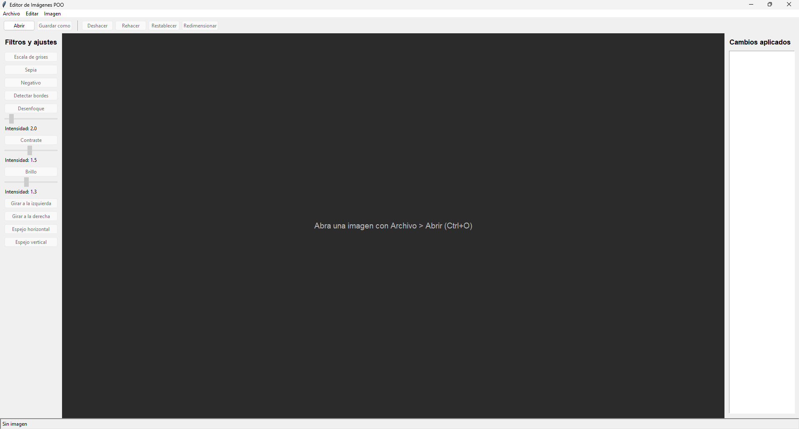

# Editor de Imágenes POO

Aplicación de escritorio en Python para abrir una imagen, aplicarle filtros y transformaciones con vista previa inmediata, deshacer o rehacer cada cambio y exportar el resultado. Está construida con programación orientada a objetos, Tkinter y Pillow.



## 1. Descripción del problema

Retocar una foto sencilla (pasarla a blanco y negro, girarla, ajustar el brillo o reducir su tamaño para enviarla) suele obligar a instalar programas pesados o a subir la imagen a páginas web de terceros. Este proyecto ofrece una herramienta liviana y local que resuelve esas tareas comunes sin conexión a Internet y sin que la imagen salga del computador.

## 2. Objetivos

1. Permitir abrir imágenes en los formatos más comunes y ver una vista previa ajustada a la ventana.
2. Aplicar filtros de color, ajustes con intensidad regulable y transformaciones geométricas.
3. Permitir corregir errores con deshacer, rehacer y restablecer la imagen original.
4. Exportar la imagen editada en PNG, JPEG o BMP.
5. Demostrar en un proyecto real los conceptos de POO: clases, encapsulamiento, herencia, polimorfismo, abstracción y relaciones entre objetos.

## 3. Funcionalidades

1. **Abrir imagen:** carga archivos PNG, JPG, JPEG, BMP, GIF o WEBP y los muestra escalados al tamaño de la ventana. Rechaza archivos inexistentes, dañados o que no son imágenes.
2. **Aplicar filtros:** escala de grises, sepia, negativo y detección de bordes.
3. **Ajustes con intensidad:** desenfoque, contraste y brillo, cada uno con un deslizador que limita el valor a su rango válido.
4. **Transformaciones:** girar a la izquierda o a la derecha, espejo horizontal o vertical y redimensionar a un tamaño en píxeles elegido por el usuario (con validación de la entrada).
5. **Historial de cambios:** deshacer (Ctrl+Z), rehacer (Ctrl+Y), restablecer la original y lista visible de los cambios aplicados.
6. **Exportar:** guarda la imagen editada en PNG, JPEG o BMP sin alterar el archivo original.

## 4. Tecnologías utilizadas

| Tecnología | Uso en el proyecto |
|---|---|
| Python 3.9 o superior | Lenguaje principal |
| Tkinter (incluida con Python) | Interfaz gráfica: ventana, menús, botones, deslizadores, lienzo y diálogos |
| Pillow | Lectura, procesamiento y escritura de imágenes |
| pytest | Pruebas automatizadas |
| Git y GitHub | Control de versiones y entrega |

## 5. Instalación

Requisitos: Python 3.9 o superior con Tkinter. En Windows y en el instalador oficial de macOS Tkinter viene incluido; en Linux puede requerir `sudo apt install python3-tk`.

1. Clonar el repositorio:

```bash
git clone https://github.com/USUARIO/editor-imagenes.git
```

```bash
cd editor-imagenes
```

2. Crear y activar un entorno virtual:

```bash
python3 -m venv .venv
```

```bash
source .venv/bin/activate
```

En Windows: `.venv\Scripts\activate`

3. Instalar las dependencias:

```bash
pip install -r requirements.txt
```

## 6. Ejecución

```bash
python main.py
```

Para ejecutar las pruebas automatizadas:

```bash
python -m pytest
```

## 7. Manual de usuario

1. **Abrir una imagen.** Use *Archivo > Abrir* o el botón **Abrir** (Ctrl+O). Puede probar con `recursos/ejemplo.png`. La barra inferior muestra el nombre, el tamaño en píxeles y el modo de color.

   

2. **Aplicar un filtro.** Haga clic en cualquier botón del panel izquierdo. El resultado aparece de inmediato y el cambio se agrega a la lista *Cambios aplicados* de la derecha.

   

3. **Ajustar la intensidad.** En *Desenfoque*, *Contraste* y *Brillo*, mueva el deslizador antes de pulsar el botón. La etiqueta muestra el valor que se aplicará.

4. **Redimensionar.** Pulse **Redimensionar** o use *Imagen > Redimensionar...* e ingrese el ancho y el alto. Si escribe un valor no numérico, cero, negativo o mayor a 8000, la aplicación muestra un aviso y no modifica la imagen.

   

5. **Deshacer y rehacer.** Use los botones de la barra o Ctrl+Z y Ctrl+Y. **Restablecer** vuelve a la imagen original (y también se puede deshacer).

6. **Guardar.** Pulse **Guardar como** (Ctrl+S), elija carpeta, nombre y formato. El archivo original no se modifica.

## 8. Estructura del proyecto

```
editor-imagenes/
├── main.py                     Punto de entrada: crea el catálogo, el editor y la ventana
├── modelos/                    Entidades del dominio
│   ├── imagen.py               Clase Imagen: encapsula la imagen de Pillow
│   ├── filtros.py              Clase abstracta Filtro y sus implementaciones
│   └── excepciones.py          Errores propios del editor
├── servicios/                  Lógica de la aplicación
│   ├── editor.py               EditorImagen: coordina cargar, aplicar, deshacer y guardar
│   ├── historial.py            Historial de estados para deshacer y rehacer
│   └── catalogo.py             CatalogoFiltros: filtros disponibles en la interfaz
├── interfaz/                   Interfaz gráfica (Tkinter)
│   ├── ventana_principal.py    Ventana, menús, barra de herramientas y callbacks
│   ├── panel_filtros.py        Panel de botones y deslizadores generado desde el catálogo
│   └── visor_imagen.py         Lienzo que muestra la vista previa escalada
├── pruebas/                    Pruebas automatizadas con pytest
├── recursos/ejemplo.png        Imagen de ejemplo para probar la aplicación
├── docs/
│   ├── INFORME_TECNICO.md      Diseño, arquitectura, POO, pruebas y proceso
│   └── imagenes/               Capturas de pantalla
├── requirements.txt
└── pytest.ini
```

## 9. Autor

1. Juan Sebastian Macias Florez
2. Programación Orientada a Objetos con Python
3. macias_juan0036@americana.edu.co