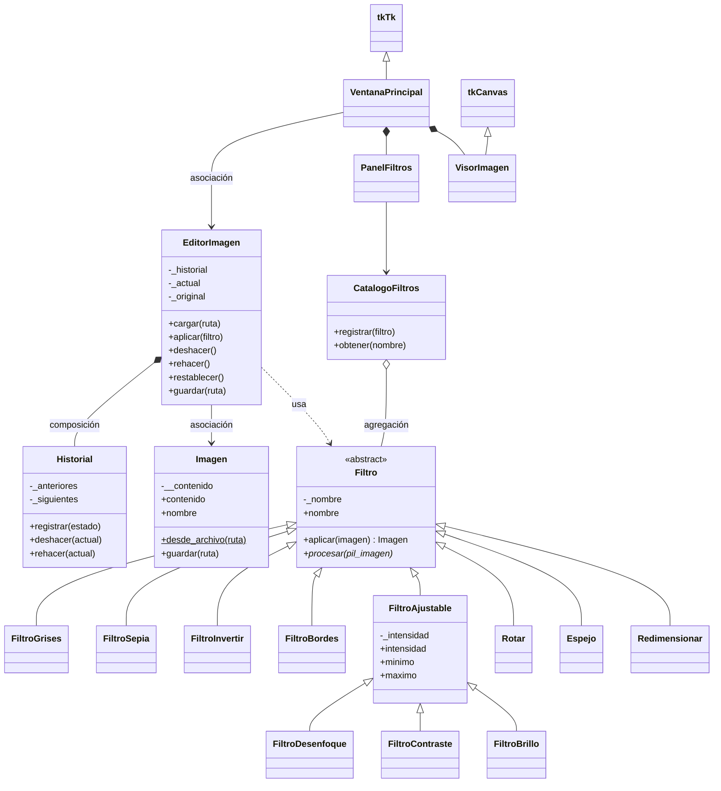
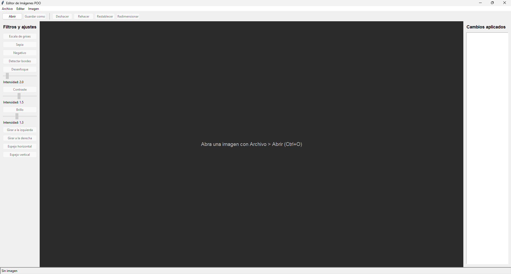

# Informe técnico: Editor de Imágenes POO

## 1. Análisis del problema

**Necesidad.** Muchas personas necesitan retoques básicos de una foto (blanco y negro, girarla, ajustar brillo, reducir su tamaño) y terminan usando programas pesados o páginas web que exigen subir la imagen. Se identificó la necesidad de una herramienta pequeña, local y fácil de usar.

**Público objetivo.** Estudiantes y usuarios sin conocimientos de edición que quieren resultados rápidos.

**Funcionalidades definidas.**

1. Abrir una imagen y verla escalada a la ventana.
2. Aplicar filtros de color y ajustes con intensidad regulable.
3. Aplicar transformaciones geométricas (girar, espejo, redimensionar).
4. Deshacer, rehacer y restablecer la imagen original.
5. Exportar el resultado en PNG, JPEG o BMP.

**Limitaciones.**

1. No hay capas, selección por zonas ni herramientas de dibujo.
2. El historial vive en memoria y se limita a 20 estados para no agotar la RAM con imágenes grandes.
3. Los filtros se aplican en el hilo principal; con imágenes muy grandes (más de 20 megapíxeles) la interfaz puede tardar un instante en responder.
4. No hay persistencia: al cerrar se pierde el historial (el enunciado no la exige).

## 2. Diseño inicial

Se partió de una pregunta: ¿qué cosas existen en el problema? La respuesta dio las clases principales.

| Clase | Responsabilidad planeada |
|---|---|
| `Imagen` | Guardar los píxeles de forma segura y saber leerse y guardarse en disco |
| `Filtro` | Contrato común: "recibo una imagen y devuelvo otra" |
| Subclases de `Filtro` | Cada efecto concreto (grises, sepia, brillo, girar...) |
| `FiltroAjustable` | Filtros con una intensidad que debe estar dentro de un rango |
| `Historial` | Recordar estados anteriores y posteriores |
| `EditorImagen` | Coordinar todo: la imagen actual, el historial y los filtros |
| `CatalogoFiltros` | Saber qué filtros se ofrecen al usuario |
| `VentanaPrincipal`, `PanelFiltros`, `VisorImagen` | Mostrar la interfaz y traducir eventos en llamadas al editor |

Una decisión temprana fue que **ningún filtro modifica la imagen que recibe**: siempre devuelve una nueva. Esto hace que deshacer sea trivial (basta con guardar la referencia anterior) y evita errores difíciles de rastrear.

## 3. Arquitectura

El código se divide en tres capas, y cada capa solo conoce a la de abajo:

```
interfaz/   (Tkinter)  ──usa──▶  servicios/  (lógica)  ──usa──▶  modelos/  (dominio + Pillow)
```

1. **modelos/**: `Imagen`, la jerarquía de `Filtro` y las excepciones. Es la única capa que llama a Pillow para transformar píxeles. No sabe que existe una interfaz.
2. **servicios/**: `EditorImagen`, `Historial` y `CatalogoFiltros`. Contiene las reglas (no aplicar sin imagen, cómo funciona deshacer). Tampoco importa Tkinter, por eso se puede probar con pytest sin abrir ventanas.
3. **interfaz/**: las clases de Tkinter. Solo reciben eventos, llaman al editor y muestran el resultado o el error.
4. **main.py**: arma los objetos (crea los filtros, el catálogo y el editor) y se los entrega a la ventana.

**Comunicación.** Cuando el usuario pulsa "Sepia", el botón ejecuta el callback `VentanaPrincipal._aplicar_filtro(filtro)`, que llama a `EditorImagen.aplicar(filtro)`. El editor guarda el estado en el `Historial`, llama a `filtro.aplicar(imagen)` y devuelve la nueva `Imagen`. La ventana entonces llama a `_actualizar()`, que refresca el visor, la lista de cambios y el estado de los botones. Si algo falla, el editor lanza una excepción de tipo `ErrorEditor` y la ventana la muestra en un cuadro de aviso.

### Diagrama de clases



## 4. Aplicación de POO

| Concepto | Clase o método | Archivo | Explicación |
|---|---|---|---|
| Clases y objetos | `Imagen`, `EditorImagen`, `Historial`, `CatalogoFiltros`, filtros | `modelos/`, `servicios/` | Cada clase tiene una sola responsabilidad. `main.py` crea los objetos y los conecta. |
| Constructores | `__init__` de todas las clases | todos | Inicializan y validan el estado (por ejemplo, `Imagen` normaliza el modo de color y rechaza objetos que no son imágenes). |
| Encapsulamiento | `Imagen.__contenido` y la propiedad `contenido` | `modelos/imagen.py` | Los píxeles se guardan en un atributo privado y solo se entregan como **copia**. Así nadie puede alterar una imagen guardada en el historial. |
| Encapsulamiento | `FiltroAjustable.intensidad` (`@property` con setter) | `modelos/filtros.py` | El setter rechaza textos y valores fuera de rango con `ErrorParametro`. Es imposible dejar un filtro en un estado inválido. |
| Encapsulamiento | `Historial._anteriores`, `_siguientes` | `servicios/historial.py` | Las pilas solo cambian con `registrar`, `deshacer` y `rehacer`, que mantienen el orden correcto y el límite de memoria. |
| Herencia | `FiltroAjustable(Filtro)` y `FiltroDesenfoque`, `FiltroContraste`, `FiltroBrillo` | `modelos/filtros.py` | Las tres subclases heredan la validación de intensidad y solo declaran su rango con `super().__init__(...)`. |
| Herencia | `VisorImagen(tk.Canvas)`, `VentanaPrincipal(tk.Tk)`, `PanelFiltros(ttk.Frame)` | `interfaz/` | Reutilizan todo el comportamiento de Tkinter y agregan lo propio del editor. |
| Polimorfismo | `Filtro.procesar()` y `EditorImagen.aplicar(filtro)` | `modelos/filtros.py`, `servicios/editor.py` | El editor llama `filtro.aplicar(imagen)` sin saber qué filtro es; cada subclase responde con su propia versión de `procesar()`. |
| Polimorfismo | `__str__` en `Filtro` y `FiltroAjustable` | `modelos/filtros.py` | La lista de cambios muestra "Sepia" o "Contraste (2.5)" según el tipo de filtro, con la misma llamada `str(filtro)`. |
| Abstracción | `Filtro(ABC)` con `@abstractmethod procesar` | `modelos/filtros.py` | Define el contrato "recibo una imagen y devuelvo otra". No se puede instanciar `Filtro` directamente. |
| Composición | `EditorImagen` crea su `Historial` | `servicios/editor.py` | El historial nace y muere con el editor; no tiene sentido fuera de él. |
| Agregación | `CatalogoFiltros` recibe filtros ya creados | `servicios/catalogo.py`, `main.py` | Los filtros se crean en `main.py` y existen independientemente del catálogo. |
| Asociación | `VentanaPrincipal` y `EditorImagen` | `interfaz/ventana_principal.py` | La ventana recibe el editor construido y lo usa, pero no lo crea. |
| Asociación (uso) | `EditorImagen.aplicar(filtro)` | `servicios/editor.py` | El editor usa un filtro durante una operación sin guardarlo. |

### Fragmentos clave

**Abstracción y método plantilla.** `aplicar()` es igual para todos; solo cambia `procesar()`:

```python
class Filtro(ABC):
    def aplicar(self, imagen):
        if not isinstance(imagen, Imagen):
            raise TypeError("aplicar() espera un objeto Imagen.")
        resultado = self.procesar(imagen.contenido)
        return Imagen(resultado, imagen.nombre)

    @abstractmethod
    def procesar(self, pil_imagen):
        """Recibe una imagen de Pillow y devuelve otra transformada."""
```

**Herencia con `super()` y encapsulamiento con validación:**

```python
class FiltroContraste(FiltroAjustable):
    def __init__(self, factor=1.5):
        super().__init__("Contraste", "Aumenta o reduce la diferencia entre tonos.", 0.1, 3.0, factor)

    def procesar(self, pil_imagen):
        return _sobre_rgb(pil_imagen, lambda rgb: ImageEnhance.Contrast(rgb).enhance(self.intensidad))
```

**Polimorfismo en el editor.** El editor no tiene un `if` por cada filtro:

```python
def aplicar(self, filtro):
    self._exigir_imagen()
    resultado = filtro.aplicar(self._actual)
    self._historial.registrar((self._actual, list(self._operaciones)))
    self._actual = resultado
    self._operaciones.append(str(filtro))
    return resultado
```

Gracias a esto, agregar un filtro nuevo solo requiere escribir su clase y registrarlo en `main.py`: el editor y el panel de la interfaz funcionan sin cambios.

## 5. Construcción de la interfaz

**Biblioteca.** Se eligió **Tkinter** porque viene incluida con Python (no agrega dependencias), es suficiente para una aplicación de escritorio de este tamaño y se integra con Pillow mediante `ImageTk.PhotoImage`.

**Diseño.** La ventana tiene cinco zonas:

1. Barra de menús: *Archivo* (Abrir, Guardar como, Salir), *Editar* (Deshacer, Rehacer, Restablecer) e *Imagen* (Redimensionar).
2. Barra de herramientas con los botones de uso frecuente.
3. Panel izquierdo (`PanelFiltros`) con un botón por filtro y deslizadores para los ajustables.
4. Visor central (`VisorImagen`) que escala la imagen al espacio disponible.
5. Lista derecha de cambios aplicados y barra de estado inferior con nombre, tamaño y modo de color.

**Controles implementados.** Botones (`ttk.Button`), deslizadores (`ttk.Scale`), lienzo (`tk.Canvas`), lista (`tk.Listbox`), menús (`tk.Menu`), diálogos de archivo (`filedialog`), diálogos de entrada (`simpledialog`) y avisos (`messagebox`).

**Eventos y callbacks.**

| Evento | Callback | Acción en la lógica |
|---|---|---|
| Clic en un botón de filtro | `lambda: self._al_aplicar(filtro)` | `EditorImagen.aplicar(filtro)` |
| Mover un deslizador | `al_mover(texto)` | asigna `filtro.intensidad` (validada por el setter) |
| Ctrl+O, Ctrl+S, Ctrl+Z, Ctrl+Y | `self.bind("<Control-o>", ...)` | `cargar`, `guardar`, `deshacer`, `rehacer` |
| Cambio de tamaño de la ventana | `<Configure>` en `VisorImagen` | vuelve a escalar la vista previa |
| Opciones del menú | `command=self._abrir`, etc. | según la opción |

**Comunicación con las clases.** Todos los callbacks pasan por `VentanaPrincipal._ejecutar(accion, *argumentos)`, que captura `ErrorEditor`, muestra el mensaje y, si todo salió bien, llama a `_actualizar()`. Así el manejo de errores está en un solo lugar y la interfaz no contiene lógica de imágenes.

**Generación dinámica.** `PanelFiltros` construye sus botones recorriendo el `CatalogoFiltros`; si el filtro es un `FiltroAjustable`, agrega además un deslizador con el rango que el propio filtro declara (`minimo`, `maximo`).

**Capturas.**

1. Ventana principal: `docs/imagenes/ventana_principal.png`
2. Imagen abierta: `docs/imagenes/abrir_imagen.png`
3. Filtro aplicado con historial: `docs/imagenes/filtro_aplicado.png`
4. Aviso por entrada inválida: `docs/imagenes/error_entrada.png`



## 6. Proceso de desarrollo

1. **Formulación de la idea.** Se buscó un proyecto pequeño pero útil donde la herencia y el polimorfismo surgieran de forma natural: los filtros de imagen comparten una operación (aplicar) con comportamientos distintos.
2. **Identificación de funcionalidades.** Se priorizaron abrir, filtrar, deshacer y guardar; los ajustes con intensidad y redimensionar se agregaron después para demostrar validación de entradas.
3. **Diseño de clases.** Se definió primero la clase abstracta `Filtro` y el principio de que los filtros no modifican la imagen original.
4. **Construcción de la lógica.** Se programaron `Imagen`, los filtros, `Historial` y `EditorImagen` sin interfaz, comprobando cada parte con pytest.
5. **Desarrollo de la interfaz.** Se construyeron el visor, el panel generado desde el catálogo y la ventana con menús y atajos.
6. **Integración.** `main.py` une las capas. Se centralizó el manejo de errores en `_ejecutar()`.
7. **Pruebas y correcciones.** Se ejecutaron las 31 pruebas automatizadas y pruebas manuales en la interfaz; se corrigieron los problemas descritos en la sección 8.

## 7. Pruebas

Se escribieron 31 pruebas automatizadas con pytest (`python -m pytest`), todas aprobadas. Además se realizaron las siguientes pruebas manuales en la interfaz:

| Prueba | Acción realizada | Resultado esperado | Resultado obtenido |
|---|---|---|---|
| Prueba 1 | Abrir `recursos/ejemplo.png` y aplicar *Sepia* | La imagen cambia a tonos sepia, la lista muestra "1. Sepia" y la barra muestra 640 x 420 px | Correcto |
| Prueba 2 | Aplicar *Negativo* y *Girar a la izquierda*, luego pulsar Deshacer dos veces y Rehacer una vez | Vuelve a la original y luego reaparece solo el negativo | Correcto |
| Prueba 3 (error) | En *Redimensionar* escribir "abc" como ancho | Aviso "El ancho debe ser un número entero." y la imagen no cambia | Correcto |
| Prueba 4 (error) | Abrir un archivo de texto renombrado a `.png` | Aviso "El archivo no es una imagen válida" y el editor sigue funcionando | Correcto |
| Prueba 5 (error) | Pulsar Deshacer sin cambios previos | El botón aparece deshabilitado; con Ctrl+Z se muestra "No hay cambios para deshacer." | Correcto |
| Prueba 6 | Rotar y guardar como `salida.jpg` | Se crea un JPEG con ancho y alto intercambiados; el original no cambia | Correcto |

Pruebas automatizadas destacadas:

1. `test_filtro_es_abstracto`: no se puede instanciar `Filtro`.
2. `test_polimorfismo_misma_llamada_distinto_resultado`: cuatro filtros reciben la misma imagen y devuelven píxeles distintos.
3. `test_aplicar_no_modifica_la_original` y `test_contenido_es_copia`: comprueban el encapsulamiento.
4. `test_redimensionar_entradas_invalidas` y `test_intensidad_fuera_de_rango`: validan entradas incorrectas.
5. `test_deshacer_y_rehacer`, `test_cambio_nuevo_anula_rehacer`, `test_historial_respeta_limite`: comportamiento del historial.

## 8. Problemas y soluciones

**Problema 1: la vista previa fallaba al abrir la aplicación.**
*Diagnóstico:* al cargar una imagen antes de que la ventana terminara de dibujarse, el lienzo medía 1x1 píxeles. Al restarle el margen se pedía a Pillow un tamaño negativo y aparecía `ValueError: scale must be > 0`.
*Solución:* `VisorImagen._redibujar()` no dibuja si el lienzo todavía es más pequeño que el doble del margen. Cuando la ventana aparece, el evento `<Configure>` vuelve a llamar a `_redibujar()` con el tamaño real.

**Problema 2: la imagen desaparecía del lienzo.**
*Diagnóstico:* Tkinter no conserva una referencia a la `PhotoImage` que se dibuja. Al salir del método, Python la eliminaba y el lienzo quedaba vacío sin mostrar error.
*Solución:* guardar la `PhotoImage` en el atributo `self._foto` del visor, para que viva mientras se muestra.

**Problema 3: deshacer devolvía una imagen ya modificada.**
*Diagnóstico:* en una primera versión, la propiedad `contenido` devolvía el objeto interno de Pillow. Un filtro que lo modificaba en el lugar alteraba también la imagen guardada en el historial.
*Solución:* encapsular el contenido en `__contenido` y devolver siempre una copia; además, cada filtro devuelve una `Imagen` nueva. La prueba `test_contenido_es_copia` evita que el error vuelva.

**Problema 4: las imágenes con transparencia perdían el canal alfa o fallaban.**
*Diagnóstico:* funciones como `ImageOps.invert` o `ImageOps.grayscale` no aceptan imágenes RGBA, y JPEG no admite transparencia.
*Solución:* la función auxiliar `_sobre_rgb()` aplica el efecto solo sobre los canales de color y reinserta el alfa; `Imagen.guardar()` convierte a RGB antes de guardar en JPEG o BMP.

## 9. Conclusiones

1. La clase abstracta `Filtro` fue la decisión más valiosa: convirtió cada efecto en una pieza intercambiable y permitió que el editor y la interfaz no cambien al agregar filtros.
2. El encapsulamiento resultó necesario, no decorativo: sin copias protegidas, el historial de deshacer se corrompía.
3. Separar modelos, servicios e interfaz permitió probar toda la lógica con pytest sin abrir ventanas.
4. Las principales dificultades estuvieron en detalles de Tkinter (tamaño inicial del lienzo, referencias a imágenes) más que en la lógica.

**Mejoras posibles.**

1. Aplicar filtros en un hilo aparte (`threading`) para no congelar la interfaz con imágenes muy grandes.
2. Vista previa en vivo mientras se mueve el deslizador.
3. Recorte por selección con el mouse.
4. Comparación lado a lado entre la original y la editada.
